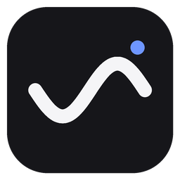
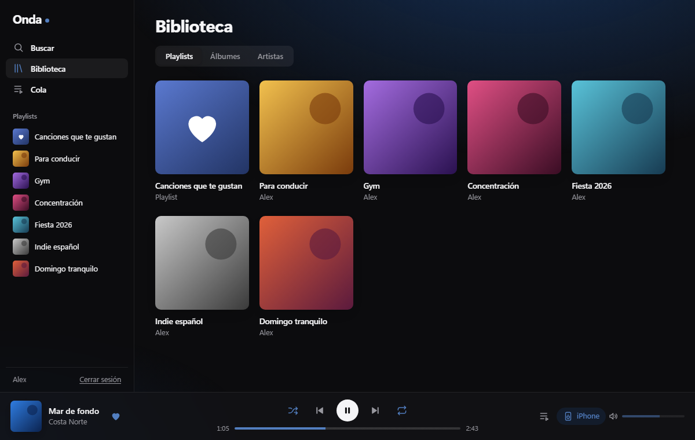
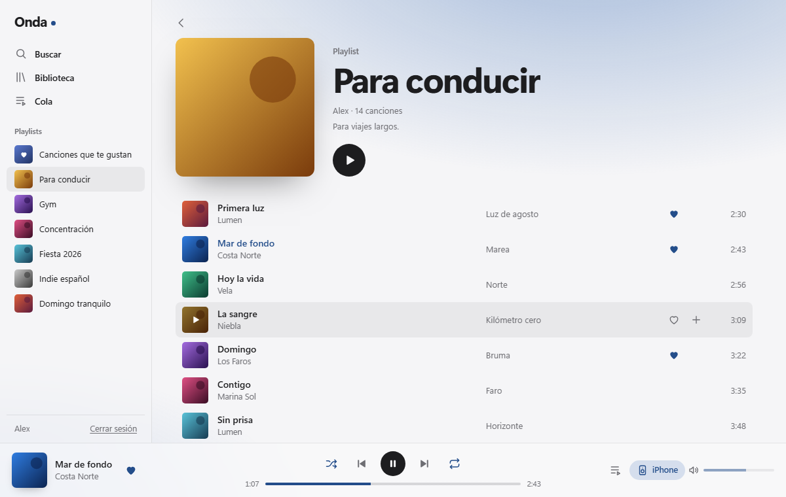
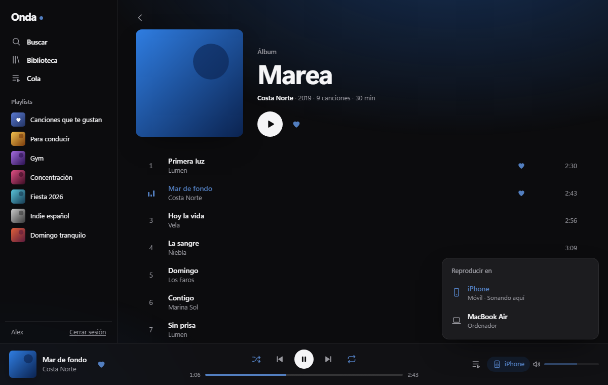
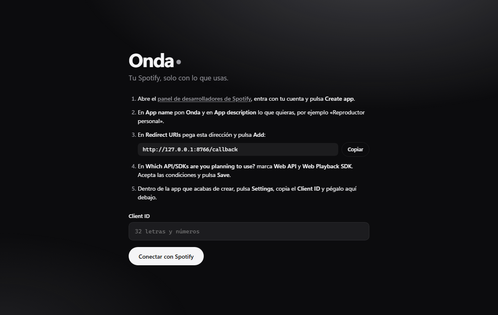

<p align="center"></p>

<h1 align="center">Onda</h1>

<p align="center">Un reproductor de Spotify ligero y limpio para Windows, solo con lo que usas.<br>
Código abierto, gratis y hecho con la API oficial de Spotify.</p>

<p align="center"></p>

## Qué es

Onda es un cliente de escritorio para Spotify con lo justo:

- **Buscar** canciones, artistas, álbumes y playlists.
- **Tu biblioteca**: playlists, canciones que te gustan, álbumes guardados y artistas que sigues.
- **Cola**: qué suena ahora y qué viene después; añade canciones con el botón **+**.
- **Reproduce en el propio PC** o **controla otro dispositivo** (móvil, otro ordenador, altavoces) con Spotify Connect.
- **Diseño adaptativo**: la ventana toma el color de la portada que suena y sigue el modo claro u oscuro del sistema.

Lo que **no** es: no descarga música, no quita anuncios, no funciona sin Premium y no modifica la app oficial de Spotify. Todo pasa por la [Web API](https://developer.spotify.com/documentation/web-api) y el [Web Playback SDK](https://developer.spotify.com/documentation/web-playback-sdk) oficiales.

> Onda es un proyecto independiente. No está afiliado a Spotify ni respaldado por Spotify. «Spotify» es una marca registrada de Spotify AB.

<p align="center">


</p>

## Por qué consume menos

La app oficial de escritorio es un navegador Chromium completo empaquetado. Onda usa **WebView2**, el motor web que ya trae Windows, y una interfaz mínima sin secciones que no uses.

En un PC de pruebas, medido igual nada más abrir cada app:

| | Memoria privada | Tamaño |
|---|---|---|
| App oficial de Spotify | ~740 MB | — |
| Onda | ~231 MB | ~12 MB (.exe) |

Las cifras varían según el equipo. Tómalas como orientación, no como garantía.

## Requisitos

- **Windows 10 u 11** con **WebView2** (viene instalado en Windows 11; en Windows 10 se descarga gratis desde [Microsoft](https://developer.microsoft.com/microsoft-edge/webview2/)).
- Una cuenta de **Spotify Premium**. Spotify la exige para reproducir y para usar su API en modo desarrollo.
- Conexión a internet.

## Instalación

1. Entra en **[Releases](../../releases/latest)** y descarga **`Onda.exe`**.
2. Guárdalo donde quieras (por ejemplo, en una carpeta `Onda` dentro de Documentos) y ábrelo con doble clic.
3. Como el .exe no está firmado, Windows puede mostrar **«Windows protegió su PC»**. Pulsa **Más información** y después **Ejecutar de todas formas**. Si prefieres no fiarte del .exe, [compílalo tú mismo](#compilar-desde-el-código).

No hace falta instalar nada más.

## Primer arranque: conectar tu cuenta

Spotify obliga a que cada persona cree su propia «app» de desarrollador (es gratis) y use su **Client ID**. Onda te guía en pantalla, pero aquí tienes los pasos:

<p align="center"></p>

1. Abre Onda y pulsa el enlace **panel de desarrolladores de Spotify** (o ve a [developer.spotify.com/dashboard](https://developer.spotify.com/dashboard)). Entra con tu cuenta de Spotify.
2. Pulsa **Create app**.
3. En **App name** escribe `Onda`. En **App description** pon cualquier cosa, por ejemplo `Reproductor personal`.
4. En **Redirect URIs** pega exactamente esta dirección y pulsa **Add**:
   ```
   http://127.0.0.1:8765/callback
   ```
   En Onda tienes un botón **Copiar** al lado de la dirección.
5. En **Which API/SDKs are you planning to use?** marca **Web API** y **Web Playback SDK**.
6. Acepta las condiciones de Spotify y pulsa **Save**.
7. Dentro de la app recién creada, pulsa **Settings** y copia el **Client ID** (32 letras y números).
8. Vuelve a Onda, pega el Client ID en el campo **Client ID** y pulsa **Conectar con Spotify**.
9. Se abre la página de Spotify: revisa los permisos y pulsa **Aceptar**. Volverás a Onda con tu biblioteca cargada.

Solo se hace una vez. Onda recuerda la sesión.

## Cómo se usa

| Acción | Cómo |
|---|---|
| Reproducir una canción | Doble clic en la fila, o pasa el ratón por la portada y pulsa ▶ |
| Reproducir un álbum o playlist entero | Botón redondo ▶ de la cabecera |
| Pausar o reanudar | Botón central de abajo o tecla **Espacio** |
| Buscar | **Buscar** en la barra lateral, o teclas **/** o **Ctrl + F** |
| Guardar canción, álbum o seguir artista | Corazón ♡ |
| Añadir a la cola | Botón **+** de cada fila |
| Ver la cola | **Cola** en la barra lateral o el icono de lista abajo a la derecha |
| Cambiar dónde suena | Botón de dispositivo, abajo a la derecha, y elige uno |
| Salir de tu cuenta | **Cerrar sesión**, abajo en la barra lateral |

**Controlar el móvil u otro ordenador:** abre Spotify en ese dispositivo para que aparezca en la lista de dispositivos de Onda. Algunos dispositivos (como el iPhone) no dejan cambiar el volumen desde fuera; en ese caso el control de volumen se desactiva.

## Limitaciones (las pone Spotify)

Desde febrero de 2026, las apps en modo desarrollo de Spotify tienen estas restricciones, y Onda no puede saltárselas:

- En las **playlists que no son tuyas** (de Spotify o de otras personas) no se puede ver la lista de canciones. Sí se pueden reproducir enteras.
- La **búsqueda** devuelve como mucho 10 resultados por tipo.
- No hay «canciones más populares» del artista, ni novedades, ni categorías. La página del artista muestra su discografía.
- Cada app de desarrollador admite como mucho **5 usuarios**. Por eso cada persona crea la suya.
- El dueño de la app de desarrollador necesita **Premium** activo.

Detalles en el [changelog oficial](https://developer.spotify.com/documentation/web-api/references/changes/february-2026).

## Privacidad

- No hay ningún servidor de Onda. La app solo habla con Spotify (`api.spotify.com`, `accounts.spotify.com` y el SDK de reproducción).
- El inicio de sesión usa OAuth con PKCE: no hay contraseñas ni secretos guardados en la app.
- Tu sesión y tu Client ID se guardan solo en tu PC, en `%APPDATA%\Onda`. **Cerrar sesión** borra la sesión (el Client ID se queda para volver a entrar; puedes cambiarlo con **Cambiar Client ID**). Para quitar del todo el acceso, ve a [spotify.com/account/apps](https://www.spotify.com/account/apps/) y pulsa **Quitar acceso** en Onda.

## Compilar desde el código

Necesitas [Python 3.12](https://www.python.org/downloads/) en Windows.

```bat
git clone https://github.com/okdigitalcontacto-boop/onda.git
cd onda
python -m pip install -r requirements.txt
build.bat
```

El ejecutable aparece en `dist\Onda.exe`. Para probar sin compilar: `python onda.py`.

Cada vez que se publica una etiqueta `v*`, GitHub Actions compila el .exe en una máquina limpia y lo sube a **Releases** (ver [`.github/workflows/build.yml`](.github/workflows/build.yml)).

### macOS (experimental)

`python onda.py` debería abrir Onda en macOS usando WKWebView. Hay que instalar las dependencias con `pip` y añadir `http://127.0.0.1:8765/callback` igual. **No está probado**: el modo de controlar otros dispositivos debería funcionar, pero reproducir dentro de la propia app depende de que WKWebView acepte el DRM de Spotify.

## Estructura

```
onda.py           Ventana de escritorio (pywebview) y servidor local para el inicio de sesión
web/index.html    Estructura de la interfaz
web/style.css     Estilos: modo claro/oscuro y color adaptativo a la portada
web/app.js        Sesión, API de Spotify, reproductor, vistas y búsqueda
make_icon.py      Genera el icono (onda.ico / onda.png)
build.bat         Compila dist\Onda.exe con PyInstaller
```

Sin frameworks ni dependencias de JavaScript: HTML, CSS y JavaScript sin más.

## Problemas frecuentes

- **«INVALID_CLIENT: Invalid redirect URI»**: la Redirect URI de tu app en el panel de Spotify no es exactamente `http://127.0.0.1:8765/callback`. Corrígela en **Settings** → **Edit** y pulsa **Save**.
- **«Onda ya está abierta»**: ya hay una ventana de Onda, o otro programa usa el puerto 8765.
- **No suena en el PC**: pulsa el botón de dispositivo y elige **Este PC (Onda)**. Si aparece el aviso de que el equipo no puede reproducir, usa Onda como mando de otro dispositivo.
- **No aparece mi móvil**: abre Spotify en el móvil y pon algo en pausa; luego vuelve a abrir la lista de dispositivos.

## Licencia

[MIT](LICENSE). Úsalo, modifícalo y compártelo libremente.
